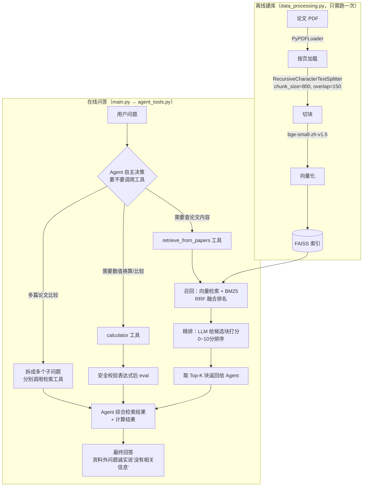

# 论文问答 RAG + Agent 项目


一个基于本地论文语料的检索增强问答系统：混合检索（向量检索 + BM25）→ LLM 精排 → Agent 自主决策是否调用检索/计算工具 → 生成有据可查的回答。

本项目不是简单的"检索 + 拼 prompt"，核心想验证两件事：
1. **检索链路本身要经得起横向对比**——同一批问题在不同切块参数、不同检索策略（纯向量 / 混合检索 / 加 LLM 精排）下反复跑过，用真实命中率数据选出最终方案，而不是随手定一套参数就收工。
2. **要不要调用工具、调用几次，交给大模型自己判断**——用 Function Calling + ReAct 范式让 Agent 自己决定什么时候检索、什么时候算数字、遇到资料外的问题时诚实说"不知道"而不是编答案。

本 README 的"从零跑通"步骤，已经在这个项目文件夹里真实跑了一遍（建库 + 跑 main.py），详见文末"复现性自测记录"。

## 架构流程



两阶段检索设计的取舍：召回阶段（向量 + BM25）追求"宁可错杀不可放过"，先捞一批候选；精排阶段用 LLM 当 cross-encoder 重新打分排序，弥补向量检索对专业术语/数字不敏感的短板。

Agent 侧用 ReAct 范式（推理→行动→观察→再推理……），核心是把"要不要检索、检索几次、要不要算数字"这些决策权交给大模型自己判断，而不是人工写死调用逻辑——这是本项目和"固定流程的 RAG demo"的主要区别。

## 目录结构

```
rag实验/
├── config.py            # 全项目统一配置（embedding模型、切块参数、路径、DeepSeek API）
├── vectorstore.py        # embedding 包装器 + FAISS 存取
├── data_processing.py    # 离线建库：PDF -> 切块 -> 向量化 -> 存入 FAISS
├── rag_pipeline.py        # 在线检索：混合检索(向量+BM25) + LLM 精排
├── agent_tools.py         # Agent 工具定义（retrieve_from_papers / calculator）+ 组装
├── main.py                # 项目入口：跑测试题
├── requirements.txt       # 依赖清单（实测版本号）
├── rag语料库/              # 语料库PDF（项目自带，默认直接能用）
└── faiss_index_c800_o150/   # 建库后生成的索引（跑完 data_processing.py 才会出现，不纳入版本控制）
```

## 环境准备

### 1. 安装依赖

```bash
conda create -n rag_agent python=3.10
conda activate rag_agent
pip install -r requirements.txt
```

`requirements.txt` 里的版本号是在真实环境里核对过的。如果目标机器有 NVIDIA 显卡想用 GPU 加速 embedding，torch 需要单独去 https://pytorch.org/get-started/locally/ 按自己的 CUDA 版本装对应的 `+cuXXX` 版本（直接按 requirements.txt 装到的是 CPU 版）。

### 2. 设置环境变量

| 环境变量 | 是否必须 | 作用 |
|---|---|---|
| `DEEPSEEK_API_KEY` | **必须** | DeepSeek API 密钥，没设的话 `agent_tools.py` 会直接报错退出（提示文字很明确，不是裸 Python 异常） |
| `RAG_CORPUS_DIR` | 可选 | 想把语料库放在项目外部某个位置时才需要设。不设的话默认用项目自带的 `rag语料库/` 文件夹，直接能用 |

**PyCharm 用户注意**：PyCharm 的"运行配置"（Run Configuration）里设的环境变量，是每个配置各自独立的，不会自动继承系统环境变量，也不会在多个运行配置之间共享。如果你在系统里设了 `DEEPSEEK_API_KEY` 但 PyCharm 里跑脚本还是报"没读到"，去 `Run -> Edit Configurations` 给对应的运行配置单独加一遍这个环境变量；如果是刚在系统里新加的环境变量，可能还需要完全重启 PyCharm（有时甚至要重启电脑）才能被新打开的运行配置识别到。

命令行设置：

Windows PowerShell：
```powershell
$env:DEEPSEEK_API_KEY = "你的key"
```
Linux/Mac：
```bash
export DEEPSEEK_API_KEY="你的key"
```

### 3. 准备语料库

项目自带 `rag语料库/` 文件夹，里面已经放了 8 篇论文 PDF，默认直接能用，不用额外配置。想换一批论文，直接把新 PDF 拖进这个文件夹替换/新增即可（换了内容记得重新跑一次建库，见下一步）。

### 4. 建库（第一次跑，或换了语料库/切块参数之后需要跑）

```bash
python data_processing.py
```

这一步会：加载 `rag语料库/` 里所有 PDF → 按 `config.py` 里的 `CHUNK_SIZE`/`CHUNK_OVERLAP` 切块 → 用 bge-small-zh-v1.5 做向量化 → 存进 `faiss_index_c800_o150/` 文件夹。

CPU 环境下，8 篇论文（约 100 页、600 多块）跑完大概 1 分钟左右。模型会从 HuggingFace 镜像站（`hf-mirror.com`，`config.py` 里已经配好）自动下载，第一次跑会多花一点时间下载模型。

### 5. 跑项目

```bash
python main.py
```

会依次跑测试题，打印出 Agent 每一步的推理/行动/观察轨迹，可以看到它什么时候调用检索工具、什么时候调用计算器、以及最终的回答。

## 配置可调项（config.py）

- `CHUNK_SIZE` / `CHUNK_OVERLAP`：切块参数，默认 800/150。改了之后要重新跑 `data_processing.py`，索引目录名里带着参数（`faiss_index_c800_o150`），新旧索引不会互相覆盖。
- `CANDIDATE_K` / `FINAL_K`：召回阶段先捞多少候选 / 精排阶段最终送几个给生成模型。
- `RRF_K`：混合检索 RRF 融合公式里的平滑常数。
- `DEEPSEEK_MODEL`：目前用的是 `deepseek-flash`（`deepseek-chat` 已在 2025-07-24 停用）。

## 复现性自测记录

2026-10-11，在这个项目文件夹（只有代码 + `rag语料库/`，没有任何历史产物）里按 `requirements.txt` 装好依赖后，实测跑通：

- `data_processing.py`：8 篇 PDF 全部正常加载，切出 619 块，embedding 模型从 hf-mirror 正常下载，CPU 上向量化用时约 60 秒，索引正常保存到 `faiss_index_c800_o150/`。
- `main.py`：正确加载刚建好的索引（619 块），在没设 `DEEPSEEK_API_KEY` 的情况下给出清晰的中文提示并退出（不是裸异常），行为符合预期。
- `config.py` 路径逻辑：不设 `RAG_CORPUS_DIR` 时默认解析到项目自带的 `rag语料库/`（已验证能扫到全部 8 个 PDF）；设了之后能正确覆盖到指定位置——两种情况都测过。

结论：只要有真实的 `DEEPSEEK_API_KEY`，这个项目文件夹是自包含的，单独拷贝/clone 到别的机器也能从零跑通。

## 评测报告

切块参数对比、混合检索、LLM 重排序、Agent 工具调用/多步推理等一系列对比实验的完整过程和数据，见 [评测报告.md](评测报告.md)。

## License

本项目采用 [MIT License](LICENSE)。
